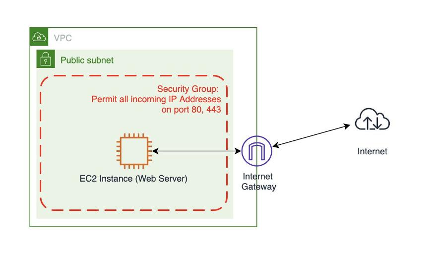

# 🚀 AWS EC2 Deployment with Terraform

## 📌 Overview
Demonstration of **Infrastructure as Code (IaC)** using Terraform to deploy an Amazon EC2 instance running Amazon Linux 2023 on AWS.

## 🏗️ Architecture

<!-- Add your architecture diagram here -->


## ⚙️ AWS Resources
- 🖥️ Amazon EC2
- 🌐 VPC & Public Subnet
- 🔒 Security Group
- 🌍 Internet Gateway
- 📡 Route Table

## 🚀 Deployment

```bash
terraform init
terraform fmt
terraform validate
terraform plan -out=tfplan
terraform apply tfplan
```

To retrieve the EC2 public IP:

```bash
terraform output url_web
```

To destroy the infrastructure:

```bash
terraform destroy
```

## 🎯 Objective
An example using Terraform for provisioning infrastructure on AWS, including network and security configuration, as well as Terraform outputs.

